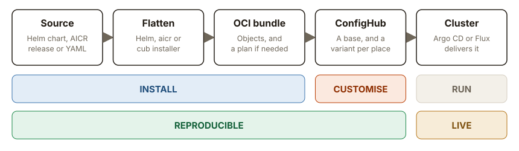

# The configuration processing model

This page explains how the Catalog treats configuration.
[The detail page](./model-reference.md) has the full definitions of each step
in the model.

## The model in one line

**Flatten it. Put it in an OCI bundle, with a plan if it needs one. Load it
into ConfigHub.**



- **Install** decides which objects exist. If they are wrong, change the source
  and flatten again.
- **Customise** changes a copy for one place. If the objects are right and this
  place differs, change it in ConfigHub.
- **Everything before the cluster is recorded, so it is reproducible.** The cluster
  is live.

To **flatten** is to run a tool once and keep the plain Kubernetes objects it makes.
A **plan** lists the steps those objects cannot carry. **ConfigHub** is the service
that stores your objects with a history of every change, and publishes them for
Argo CD or Flux to deliver.

That is the whole model. The rest of this page follows configuration in the order
it travels, starting with what the Catalog holds.

## What is in the Catalog

The Catalog is a list of configurations that have already been worked out. Each
**entry** is one pinned choice, such as Karpenter 1.14.0 with its `eks-inference`
preset. A **preset** is one named set of values for a chart version. An entry records
what went in, what came out, and what has been checked.

| An entry holds | Why |
| --- | --- |
| The recipe: the source, its version and the choices | So the same result can be produced again. |
| The flattened objects, with a digest | So you can read what would be installed without running anything. |
| A flattening verdict | So you know whether the objects alone are enough. |
| A plan, if the entry needs one | So the steps objects cannot carry are written down. |
| OCI references, where published | So you can pull it with no clone and no account. |
| Receipts | So each claim names the run behind it, and what has not run is stated. |

The Catalog holds no cluster, no Secrets and nothing of yours. It doesn't replace
a generator. It runs each generator once and keeps the result, because the result
is what you need to read, compare and deliver.

### Every type of config ends up as objects

A **generator** is the tool that turns a type of config into Kubernetes objects.
Some types have no generator, because they are already objects.

| Type of config | Generator | What you choose | What the Catalog keeps | Entries |
| --- | --- | --- | --- | --- |
| Helm chart | `helm template` | A version and values | Plain objects, for each preset | 345 |
| NVIDIA AICR recipe | `aicr`, then `helm template` | Five criteria: service, accelerator, OS, intent and platform | Argo CD Applications. Most still name a chart that Argo CD renders later. | 138 |
| Plain YAML | None | Which file | The objects as they are | 39 |
| Timoni module | `timoni build` | A version and values | Plain objects | 2 |
| Installer package | `cub installer` | A preset and inputs | Plain objects | 1 |
| Configuration OCI | None | A digest | The objects as they are | 1 |
| Kubara platform | Kubara | The platform's inputs | Argo CD bootstrap objects | 1 |
| Sveltos ClusterProfile | None | Which profile | The profile as it is | 1 |

Helm and AICR have the most entries because each is one choice among many. One
chart version with three presets is three entries, and AICR has one entry for each
combination of criteria the Catalog keeps. The installer package row counts the one
entry listed under that format. Almost every Helm entry is also held in an installer
package.

## Step 1. Flatten

Before flattening, you choose a recipe. Flattening runs the source's own tool once
and keeps the objects it produces. Nothing runs that tool again when you install.

Three tools are easy to mix up, and they do different jobs.

| | Helm | AICR | `cub installer` |
| --- | --- | --- | --- |
| Its job | Turn one chart and its values into objects. | Choose many charts and their values for a GPU platform, and write one Helm chart that produces their Argo CD Applications. | Take objects Helm has already made, apply a preset and any inputs, then load the result. |
| When it runs | Once, when the Catalog is built | Once, when the Catalog is built. Argo CD renders the named charts when it deploys. | On your machine, when you choose |
| How it relates | Its output is what an installer package holds. | It uses Helm. AICR entries have no installer package. | It starts where Helm finished, so it never runs Helm. AICR entries don't use it. |

### What the flattening verdict means

Every entry records a flattening verdict. It answers one question: can this
source be flattened once and delivered as plain objects?

| Verdict | What it means | What you do |
| --- | --- | --- |
| `safe-to-flatten` | The objects are everything. No step is needed around them. | Load the bundle and deliver it. |
| `flatten-with-routes` | The source is flattened, and some steps must still happen when you deliver. Those steps are the plan. "Routes" is the stored name for the plan's steps. | Load the bundle, and carry out the plan when you deliver. |
| `unsafe-to-flatten` | The objects alone are not enough. The source depends on a live lookup, generated state or a destructive lifecycle step that no plan step covers yet. | Use the installer package with `cub installer`. No bundle is published. |
| `born-flattened` | The source is already plain objects. | Load it and deliver it. |

Three questions people ask about `flatten-with-routes`.

**Is it completely flattened?** For a Helm chart, yes. Helm has run, and
nothing renders again when you install. Most plan steps are work around the
objects, such as "apply the CRDs first", "this Secret must exist" or a hook
Job. A few name a value that only your destination knows, such as a cluster
name or a region. The objects hold the placeholder `confighubplaceholder` where
that value goes, and the entry page lists it as an input the destination must
supply. You replace the placeholder for each destination before you deliver.
For an AICR recipe the bundle holds Argo CD Applications, and Argo CD still
renders the charts inside them when it deploys.

**Can I load it into ConfigHub?** Yes. `cub variant upload` loads the bundle
as a base, and you make variants of it as you do for any other entry. The plan
travels inside the bundle.

**What do I do with the plan?** Read it on the entry page, which lists each
step, who carries it out and whether the Catalog has run it. You, or your
pipeline, carry out the steps when you deliver. Where an entry page has a test
script, the script stops and names any step it cannot do for you.

## Step 2. Put it in an OCI bundle, with a plan if it needs one

An OCI bundle is one artifact in a registry. It holds the flattened objects. You
can pull, read, compare and apply it with no account. Loading it into ConfigHub, in
step 3, needs an account.

Not all source configuration can be completely flattened. The configuration
steps taken after flattening are called the plan. A bundle carries its plan, and a
bundle that needs no such step has no plan.

**A plan is a written list. It does not run itself.** Each step names who carries
it out. Karpenter 1.14.0 with its `eks-inference` preset has three.

| Step | What it says | Who carries it out |
| --- | --- | --- |
| Before apply | One schedulable node must exist outside Karpenter. | An operator |
| Before render | `AWS_REGION` must be set, because the controller stops without it. | An operator |
| At apply | Apply the 5 CRDs first, wait until they are Established, then apply the rest. | The applier you choose |

### OCI does three separate jobs

The OCI bundle is one of three kinds of OCI artifact in this model. Each has its own
digest.

| Job | What it holds | What happens next |
| --- | --- | --- |
| Source | A chart, an installer package or the Helm chart AICR writes | A tool still has to run. |
| Literal | The objects themselves, with their plan. An OCI bundle is this kind. | You read, compare or load them, and no generator runs. |
| Release | One approved ConfigHub revision | Argo CD or Flux applies that exact digest. |

## Step 3. Load it into ConfigHub

```bash
cub variant upload --component gpu-operator --variant base --namespace gpu-operator "$BUNDLE"
```

The bundle becomes a **base**, and each object becomes one **Unit**. You then make a
**variant**, a copy of the base for one environment. `cub` is ConfigHub's command-line
tool. Almost every Helm entry can also come in through an installer package, and both
ways end in the same place.

| Way in | Commands | Use it when |
| --- | --- | --- |
| OCI bundle, the default | `cub variant upload` | The entry has a bundle. Any value a destination must supply is set later, in a variant. |
| Installer package | `cub installer setup`, then `cub installer upload` | The verdict forbids a bundle, or the package asks for inputs or cluster facts. |

[One dated run](./live-walk-bundle-route-2026-11-02.md) shows the OCI bundle way in,
from upload to the cluster.

## Then customise it, and deliver it

Ask whether the objects are right. If they are wrong, change what produced them.
If they are right and this place differs, change a variant.

| | Install | Customise |
| --- | --- | --- |
| Kind of intent | Developer | Operator |
| Examples | A new chart version, a component on or off, CRDs in or out | Replicas, an image or limits for one environment |
| What you change | The recipe | A variant in ConfigHub |
| Result | A new OCI bundle and a new base, which you promote to each variant | A new revision of that variant |

To customise, run a named function on the variant. Your edits stay when a new base is
promoted. Nothing reaches the cluster until you publish a release.

```bash
cub function do --space my-app-prod --unit my-app --change-desc "Run three replicas" set-replicas 3
cub release publish my-app-prod
```

**GitOps delivers. It does not decide.** Argo CD or Flux pulls the release digest,
applies it and reports the result. Each can express an ordering step, with sync
waves or dependent Kustomizations, but you have to set that up. No plan step is
marked automatic, and the Catalog's records have not yet watched a GitOps tool carry
one out, so each entry page says what has run.

## What is reproducible, and what is live

Ask whether you could get the same answer on a laptop, with no cluster and no
account. If you could, it is reproducible.

| | Reproducible | Live-dependent |
| --- | --- | --- |
| **Install** | The chart version, values, preset and AICR criteria | Cluster facts a package reads as it renders |
| **Customise** | Replicas for each environment, a limit agreed in review | The region or cluster name for this destination, scaling after a load spike, a fix during an incident |

**A live value becomes reproducible once it is recorded.** You record the region or
the cluster name by setting it in a variant, and `cub installer` writes the cluster
facts it reads to `facts.yaml`. A decision made during an incident depends on the
moment, and the change it makes is still a recorded revision. Some things stay live,
such as the health of a workload or whether a required Secret exists right now.

AICR is the exception to a full record. Its Applications name each chart by version,
and Argo CD renders those charts on the cluster, so the rendered objects are not
fixed in advance.

## Where an agent fits

An agent's decision can be unpredictable, but what it writes can't be. It either
changes the recipe or applies a named function such as `set-replicas` to a variant,
and each result is
versioned, gated and released by digest. It supplies inputs to a generator, and it
does not write the objects. The agent is the author of a change, not the authority
for it.

The loop isn't closed yet. Live fixes that flow back into desired state are still
future work.

## Every stage, in one picture

[](../images/model/whole-model.svg)

This is everything above on one page, for reference. Read it from left to right,
and read each row as one question. Select the picture to open it at full size.

## Try it

[Deploy the GPU Operator from the Catalog](./deploy-gpu-operator-from-catalog.md)
does all three steps, and then deploys and tests the result.

## Read next

| Page | What it adds |
| --- | --- |
| [The model, in detail](./model-reference.md) | The full definition of each step, and the record layers. |
| [Deploy the GPU Operator from the Catalog](./deploy-gpu-operator-from-catalog.md) | The model on one Helm chart, in five steps. |
| [One AICR v1.0.0 recipe](../demo/aicr/eks-h100-training-kubeflow-v1-0-0.md) | The model on one NVIDIA AICR recipe. |
| [What we refuse to claim](./what-we-refuse-to-claim.md) | The limits of what the Catalog says. |

## Words

This section is the one list of these words. Records and tools keep some
older names, and the last column says where a word means something else.

### Inputs

| Word | Meaning | Don't confuse it with |
| --- | --- | --- |
| Source | What a provider publishes, such as a chart or an AICR release. | |
| Recipe | One pinned choice from a source: its version and one set of values or criteria. | An **AICR recipe** is the document `aicr recipe` resolves from the criteria. The `recipes/` directory holds the Catalog's records. |
| Preset | One named set of values for a chart version, kept in its installer package. | `installer.yaml` and `cub installer setup --base` call a preset a base. |
| Input | A named value `cub installer` asks for and writes to a field. | Helm values, which are chosen before the package is built. |
| Fact | Something read from the destination and recorded before a render. | An input, which a person supplies. |
| Placeholder | The value `confighubplaceholder`, which marks a value each destination must supply. | |

### Artifacts

| Word | Meaning | Don't confuse it with |
| --- | --- | --- |
| Installer package | One OCI artifact that holds every preset of a chart version. `cub installer` flattens one preset into files. | An OCI bundle, which holds one recipe's objects. |
| OCI bundle | The flattened objects of one recipe, in one OCI artifact, with a plan if they need one. | AICR's **bundle**, the output of `aicr bundle`. Whether to rename either one is an open decision. |
| Plan | The steps that objects cannot carry. Records call them routes. | `cub fleet plan` and the other `plan` commands, which preview a change. `helm-plan.yaml`, which is a Catalog record about a chart. |
| Step | One item in a plan. | |
| Flattening verdict | The recorded answer to whether a source can be flattened once. | AICR's **validation result**, from checks against a cluster. Whether to rename "verdict" is an open decision. |
| Receipt | The recorded result of a generation, check, delivery or test. | AICR's **evidence bundle**, which records one AICR run. |

### In ConfigHub and on a cluster

| Word | Meaning | Don't confuse it with |
| --- | --- | --- |
| Base | An OCI bundle or installer output loaded into ConfigHub. | A preset in a package, before it is loaded. |
| Variant | A copy of a base with your changes for one environment. | |
| Unit | One object in ConfigHub. | |
| Space | The ConfigHub container that holds the Units of one base or variant. | |
| Release | One approved revision, published to OCI for delivery. | A chart's version or a Helm release. |
| Stack | A set of parts named in one manifest and checked for conflicts before it renders. | A platform. |
| Platform | What a stack becomes once it runs under governance with your apps on it. | A stack. |

### Intent and the two splits

| Word | Meaning | Don't confuse it with |
| --- | --- | --- |
| Install | Deciding which objects exist, by changing a recipe and flattening again. | Applying objects to a cluster, which is delivery. |
| Customise | Changing a variant, because the objects are right and this place differs. | Editing values, which is install. |
| Reproducible | The same inputs and recorded edits give the same objects. | Predictable decisions. An agent's decision can be unpredictable while its result is reproducible. |
| Live-dependent | Read from a cluster or another store that can change. | A recorded value, which stopped being live when it was recorded. |
| Developer intent | The pinned inputs that deterministically produce a base. | |
| Operator intent | The changes made to a variant, often in response to live operations. | A manual edit on the cluster, which ConfigHub has not recorded. |

## Technical notes and disclaimers

- Tracing one rendered field back to the input that set it is a goal, and it holds only in part. It holds where a `cub installer` function writes an input to a named field, for measured Helm cases, and for variant edits, which ConfigHub records as revisions.
- UNOFFICIAL/EXPERIMENTAL.
- The [reference page](./model-reference.md) holds the detail.
- Not every entry has a published OCI bundle yet. Each entry page says whether its bundle is published.
- For an AICR recipe, Argo CD still renders the charts inside the Applications when it deploys them.
